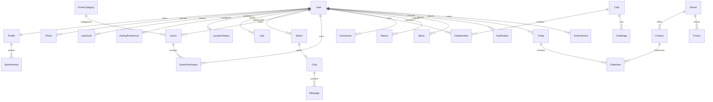

# Обновление реализации — 30 октября 2026

Исходная спецификация ниже сохранена как продуктовая база. Реализация мигрирована в monorepo: `apps/web` Next.js/React/TypeScript, `apps/api` NestJS, Prisma/PostgreSQL, MapLibre, S3, PostHog/Sentry integrations. Точные контракты: [api.md](api.md); инфраструктура: [deployment.md](deployment.md); доказательства проверок и ограничения: [verification.md](verification.md). Старые /v1 примеры ниже заменены на /api/v1. Вместо JWT/cookie используются opaque bearer-сессии с хешем в БД и отзывом; frontend хранит токен только в памяти. Redis заменён PostgreSQL rate buckets/outbox для простого modular monolith. Производственные пользователи не берутся из legacy demo. Vercel/Railway deployment требует подключённых провайдеров и секретов; статус см. verification.md.

---

# DIXON MOVEMENT — проект MVP

Дата: 29 октября 2026. Рабочее имя; Минск выбран как пилотная гипотеза. Все профили и активности в демонстрации вымышлены.

## 1. Product Vision

Помогать активным людям находить компанию и совершать совместные действия офлайн. Первый результат пользователя — договорённость о конкретной активности с конкретными людьми. North Star: число подтверждённых совместных встреч за неделю. Подтверждение после завершения события минимум двумя участниками; уникальная пара event/user исключает дубли. Отдельно считать self-reported встречи после мэтча, не смешивать их с подтверждёнными.

## 2. Позиционирование

Локальное сообщество для обычных активных людей 18+, где знакомство начинается с общего дела. Community → engagement → discovery → brand affinity → commerce. Founder — лидер и организатор, но календарь и модерация поддерживаются командой и независимыми хостами. Магазин скрыт feature flag до появления устойчивого сообщества.

## 3. JTBD

Когда хочется побегать после работы, но не с кем, найти подходящую компанию за несколько минут. Когда переехал в город, найти регулярный клуб и первые связи. Когда хочется романтического знакомства, выбрать человека с похожим образом жизни и предложить безопасную публичную активность. Когда организую тренировку, собрать людей нужного уровня без ручной переписки.

## 4. Personas

Аня, 27: недавно переехала, начинающий бегун; нужна дружелюбная группа без спортивного отбора. Максим, 33: работа и зал; хочет партнёра для падела вечером. Ира, 30: outdoor и dating; важны взаимность и скрытая геолокация. Организатор, 36: ведёт клуб; нужны лимиты, отмены и стабильный календарь. Это гипотезы для интервью, не результаты исследований.

## 5. Journey

Открытие → краткая ценность → onboarding ≤2 минут → карта/лента → карточка → join или взаимный like → приглашение → участие → подтверждение встречи → повторная активность. Барьеры: пустой город, боязнь незнакомцев, неподходящий уровень, переполненное событие. Ответы: реальный календарь организаторов, публичные места, параметры уровня, транзакционный лимит мест.

## 6. Use Cases и User Stories

UC01 вход: Telegram initData проверяется сервером; при отказе не создавать сессию. UC02 профиль: как новичок выбираю несколько интересов/целей, чтобы получить релевантные варианты. UC03 карта: как участник включаю видимость на час; после TTL исчезаю. UC04 discovery: как участник ставлю like; только взаимный like создаёт один match. UC05 события: создаю событие, присоединяюсь/выхожу; повторный запрос не меняет счётчик дважды. UC06 безопасность: блокирую человека; исчезаем друг у друга из discovery и контактов. UC07 модерация: модератор обрабатывает жалобу с reason и audit trail. UC08 встреча: после события подтверждаю участие; сервер дедуплицирует подтверждение.

Критерии: dating только 18+ и opt-in; без match нет раскрытия dating-контакта; контакт организатора только с его согласия; последнюю запись на место выигрывает одна транзакция; blocked исключаются в обоих направлениях из всех выдач.

## 7. MVP Scope

Релиз: Telegram auth, короткий onboarding, профиль/фото, интересы и цели, dating preferences, безопасная карта, TTL-статусы, rule-based discovery, like/skip/match, Telegram contact consent, события/участники/лимиты, фильтры, бот-уведомления с opt-in, block/report, базовая админка, аналитика. Позже: commerce, ML, внутренний messenger, достижения, платные подписки. Клубы в пилоте курируемые; самостоятельное создание и управление — следующая итерация.

## 8–11. Feature Map, Sitemap, IA, User Flows

Карта → слои люди/события/клубы → карточка → join/like. Найти → режимы Sport/Friends/Dating/Networking/Open → карточка → skip/like → match → пригласить. Создать → категория → параметры → время/место/лимит → preview → publish. Активности → рядом/мои/сохранённые → детали/участники → join/leave/share. Профиль → редактирование/приватность/уведомления/клубы/удаление. Вспомогательные: onboarding, notifications, report, guidelines, match, empty/error. Admin отдельный route /admin с серверным RBAC; не пункт публичной навигации.

## 12–13. Flows и wireframes

Все экраны mobile-first 390px, desktop — расширенная лента с правой колонкой.

```
ONBOARDING          КАРТА                  НАЙТИ
[1/3 Имя, ДР]       [Город ▾] [Статус]    [Цель ▾][Фильтры]
[2/3 Фото, bio]     [Слои, радиус]         [Большое фото]
[3/3 Чипы целей]    [Карта + маркеры]      [Имя, возраст]
[Приватность]       [Карточка в sheet]    [Общее, bio]
[Начать]            [5 нижних вкладок]    [Skip] [Like]

СОЗДАТЬ             АКТИВНОСТИ            ПРОФИЛЬ
[Название]          [Сегодня/выходные]    [Фото, имя]
[Категория, уровень][Карточка + фото]     [Интересы, цели]
[Дата, место]       [Время/место/уровень] [Мои активности]
[Параметры спорта]  [Участники →]         [Приватность]
[Лимит/стоимость]   [Присоединиться]      [Удаление]
[Preview → publish] [Навигация]           [Навигация]

EVENT DETAIL        MATCH                 SAFETY / ADMIN
[Фото / назад]      [Два фото]            [Причина жалобы]
[Дата / место]      [Вы в одном ритме]    [Комментарий]
[Хост / параметры]  [Написать*]           [Отправить]
[Участники/лимит]   [Позвать на бег]      [Очередь/статус]
[Join/leave/save]   [Выбрать событие]     [Решение + audit]
```

- Написать доступно только при взаимности и согласии на раскрытие контакта. Empty: расширить радиус только по выбору, показать события/клубы, создать активность; не подделывать онлайн или присутствие людей.

## 14–15. UI Kit / Design System

Токены: red #ff0505, black #000000, white #ffffff, surface #f5f5f3, muted #737373, stroke #e6e6e6. Сетка 8px; отступы 8/16/24/32/48. Заголовки 32–64px, body 16px, caption 12px; системный sans-serif. Радиусы карточек 20px, chips 999px; кнопки ≥44px. Компоненты: BottomNav, SportChip, GoalSwitch, PersonCard, EventCard, AvatarStack, StatusPill, BottomSheet, Toast, EmptyState, ReportForm. Состояния: default/hover/focus/disabled/loading/error/selected. Красный — действие, а не фон всего приложения. Фото крупные, чёрная редакционная типографика, минимум декоративных панелей. Focus visible, labels, reduced-motion, контраст, safe-area inset и клавиатурная навигация обязательны.

## 16–17. Data Model / ER

UUID keys, timestamptz UTC, отображение Europe/Minsk. Telegram ID bigint unique. DTO никогда не отдаёт private fields.



Profile: name,birth_date,city,gender,bio,level,contact_visibility,deleted_at. Photo: storage_key,position,moderation_state. SportInterest: user_id,sport_code,level; UserGoal: user_id,goal. DatingPreference: opt_in,genders,age_min/max,radius. LocationStatus: public_cell,status,audience,expires_at,show_distance; точные координаты не возвращаются. Like: actor,target,mode,decision,created_at unique(actor,target,mode). Match: canonical user_low/user_high,mode,status, unique pair/mode. Event: host,category,start/end,timezone,public_point,place,title,description,capacity,price,currency,level,status,parameters JSONB с версионированной схемой. EventParticipant: event,user,status,confirmed_at unique(event,user). Club: owner,official,chat,description,rules. Connection: canonical pair,source_event. Chat/Message: participants,body,status; в MVP хранят только consent/contact intents, не Telegram переписку. Report: reporter,target_type,target_id,reason,status,assigned_to. Block: actor,target unique; Notifications: recipient,type,payload,read_at,idempotency_key. Brand/Product/Order/OrderItem/Promo/Challenge/Achievement — зарезервированные bounded contexts; товары не имеют публичных purchase endpoints до запуска commerce. Добавить moderation_action и analytics_event append-only.

## 18. API Specification v1

REST /v1, JSON, cursor pagination {items,next_cursor}; bearer session, ошибки {code,message,request_id}; 400 validation,401 auth,403 policy,404 hidden/missing,409 conflict/full,429 rate limit. Все mutation user-scoped; Idempotency-Key для создания/join/like.

| Endpoint                             | Вход → результат                                                                        |
| ------------------------------------ | --------------------------------------------------------------------------------------- |
| POST /auth/telegram                  | {initData} → session cookie HttpOnly Secure, me; HMAC, auth_date TTL, replay protection |
| GET/PATCH /users/me                  | профиль / allowlisted поля → safe profile                                               |
| DELETE /users/me                     | revoke sessions, hide immediately, purge task                                           |
| GET /users/nearby                    | cell,radius,cursor → approximate profiles only                                          |
| GET /users/recommendations           | modes,sports,age,radius,cursor → eligible cards                                         |
| PUT/DELETE /users/me/location-status | status,cell,ttl,audience → expiry / off                                                 |
| POST /users/:id/like, /skip          | mode → decision, optional match                                                         |
| GET /matches                         | active matches only                                                                     |
| POST /matches/:id/contact            | consent → permitted Telegram link or unavailable                                        |
| GET /events, /events/nearby          | category,from,to,level,free,radius → page                                               |
| POST /events                         | validated draft → 201 event                                                             |
| GET/PATCH /events/:id                | safe detail / host editable fields                                                      |
| POST /events/:id/join, /leave        | idempotent transition → membership, count                                               |
| GET /events/:id/participants         | consent-aware limited profiles                                                          |
| POST /events/:id/confirm             | after end, participant only → confirmation                                              |
| GET /clubs, POST /clubs/:id/join     | curated listing / membership                                                            |
| POST /reports                        | target,reason,details → receipt (reporter only)                                         |
| POST /blocks                         | target → 201; revoke discovery/contact access                                           |
| GET/PATCH /notifications             | page / read receipt                                                                     |
| POST /analytics/batch                | allowlisted events with idempotent event_id                                             |
| GET /admin/reports                   | moderator only; cursor,state                                                            |
| POST /admin/actions                  | reason,target,action → immutable audit                                                  |

Event creation parameters: run {distance_km,pace_min_km,surface}; cycling {distance_km,speed_kmh,bike_type}; hiking {distance_km,elevation_m,duration_min,difficulty,equipment[]}. Server validates schema version per category. Unknown keys rejected. Host cannot reduce capacity below joined count.

## 19. Roles & Permissions

Guest: demo only. Member 18+: own profile/status, discovery, likes, join, reports. Host: own event edits/cancellation, participant roster; no private dating fields. Moderator: reports, hide content, suspend, reason required; cannot grant admin. Admin: verified/official flags, content, feature flags. Founder is verified member/host by default; no implicit administrator powers. Commerce manager later, isolated permissions. Server authorizes every object operation; client route visibility is not security.

## 20. Privacy Model

Default location OFF, dating OFF, contacts hidden. Visibility TTL max 24h, explicit audience, no precise people location in DTO/logs/analytics. Public coarse cell stable within TTL to reduce triangulation; minimum area and distance buckets; rate-limit viewport enumeration. Events have exact public meeting point with host confirmation. No home-address recommendation. Photos strip EXIF and require consent. Account deletion hides synchronously, revokes sessions, asynchronously purges personal objects; backups retention and legal exceptions defined before launch. Analytics pseudonymous, no bio, DOB, contact or exact coordinates. Export/delete requests supported in production plan.

## 21. Safety Model

18+ gate calculated from full date of birth on server; self-declared age is not identity verification. Dating requires reciprocal preferences + opt-in. Block exclusion applies globally and immediately. Reports on user/event/message; triage severity queue, review/audit, appeal channel. Verification only admin-granted after documented review; founder badge in demo is illustrative. Rate limits: auth 10/min IP, likes 60/hour/account, creates 5/day, reports 10/day with emergency override. Media quarantine before public delivery. No direct dating contact without match and contact consent. Public guidelines: consent, no harassment/discrimination/spam, safe public first meeting, do not share other people's coordinates. Operational SLA and escalation contacts must be assigned before launch.

## 22. Analytics Plan

Envelope {event_id,user_pseudo_id,session_id,name,occurred_at,schema_version,properties}; server is source of truth for match/join/purchase. Client events: app_open,onboarding_started/completed,map_opened,location_enabled,profile_viewed,swipe_left/right,event_viewed/shared,notification_clicked,product_viewed. Domain events: match_created,message_started,event_created/joined/left,user_contacted,connection_created,club_joined,purchase_started/completed. Additional: attendance_confirmed,report_submitted,status_expired. Demo collects locally; no production analytics collector is configured.

Activation funnel: onboarding → map/profile → first like → match OR join → confirmed meeting. DAU/WAU/MAU unique eligible users; retention D1/D7/D30 by local calendar cohort; engagement actions per active user; liquidity median relevant people/events per city and p50/p90 time to first join/match, including censored users. Commerce revenue only captured successful paid orders net refunds. Weekly dashboard separates organic and official events. Initial targets are hypotheses: onboarding completion ≥70%, first join within 24h ≥20%, D7 ≥25%; validate against pilot cohorts rather than treating them as benchmarks.

## 23. Edge Cases

No geo permission → choose district manually. No candidates → curated clubs/events and explicit wider radius. Duplicate join/like → unique constraints and idempotency. Simultaneous last seat → SELECT FOR UPDATE transaction. Block races → recheck before contact/join delivery. Event cancelled → notify/refund workflow if payments later. Expired status → query excludes regardless of job lag. Clock skew → server time. Offline → clear failure, retry without duplicate. Telegram username absent/private → relay invitation via bot only with opt-in, otherwise unavailable. Bot cannot initiate unsolicited conversations; request write access explicitly. Deleted host → cancel or transfer with consent. Reported event → quarantine policy; no automatic guilty verdict. Photos unavailable → initials fallback. DST/timezones stored explicitly. Underage → reject server onboarding and purge partial dating data.

## 24. Оптимальная архитектура MVP

Production target: React + TypeScript frontend; NestJS modular monolith; PostgreSQL + PostGIS; Redis rate limits/jobs; S3-compatible media; Telegram Bot API; OSM/MapLibre with provider-backed tiles. Single city and monolith keep operations simple. Domains auth/profile/discovery/events/safety/notifications/analytics; future clubs/brand/commerce via flags. API contracts first; outbox → queue → bot/analytics prevents lost messages. Rule ranking after hard filters: shared sports .35, goal .25, distance .20, level .10, events/clubs .10; block/age/dating eligibility before scoring, deterministic tie-break and no fabricated presence.

Telegram SDK initializes UI only; untrusted initDataUnsafe never authorizes. Send raw initData to server, validate Telegram HMAC and freshness; rotate server session. Bot token stays in secret store. CORS allowlist, CSRF protection for cookies, schema validation, object ownership, redacted logs, daily encrypted backups, restore drill, migration rollback, health checks and error alerts. Sources: https://core.telegram.org/bots/webapps#validating-data-received-via-the-mini-app and https://core.telegram.org/bots/webapps#initializing-mini-apps (checked 29 Oct 2026).

The delivered Site is a browser-local interactive prototype, not this production stack: static HTML/CSS/JS, localStorage, mock map and seeded people. This makes UX review possible without inventing real users or claiming live auth. Do not use real personal data in demo. Production requires bot registration, credentials, database, map provider, backend deployment and operational moderation. Those integrations are not silently simulated as real.

## 25. Roadmap / release gates

Phase 0: 8–12 interviews, confirm city/name/brand rights, recruit 5 hosts, seed 15 real events with consent. Phase 1: API/auth/schema/RBAC/privacy and media; integration tests for expired/forged auth and IDOR. Phase 2: events + capacity concurrency, map + TTL/block, discovery + reciprocal match; contract/e2e tests. Phase 3: reports/moderation, notifications, analytics and attendance; restore/security/accessibility checks. Phase 4: closed pilot 100–200 invited adults, verify liquidity and incidents weekly. Open city launch only after reliable auth, moderation owner, privacy/deletion process, concurrent joins tests and confirmed real activity supply. Clubs self-service and commerce follow retention evidence. Estimates require team and infrastructure confirmation.
